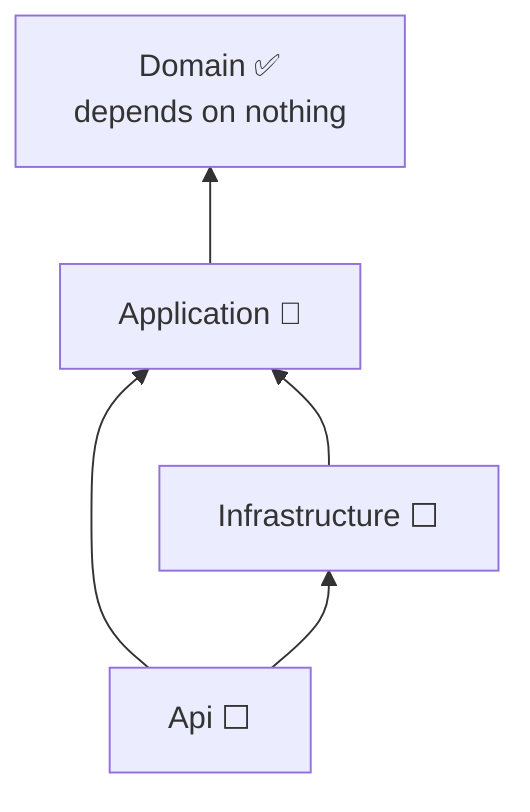

# ChaChing

The Billing application for Creative Freelancers who want to hear the cash machine go "ChaChing" !
A complete app to manage quotes, invoices and payments, following French invoicing rules.

> **Work in progress.** This project is built beside my actual job as a developer. The only goal of this project is to learn how to build an app applying Domain-Driven Design and Clean Architecture standards, and to learn how to code with Angular, with the help of Claude AI. The project is built from the inside out, design first: the domain is complete and tested, the application layer is under way, the rest is planned. See the [roadmap](docs/roadmap.md).

**Stack:** .NET 10 · C# · xUnit — then EF Core, SQL Server, ASP.NET Core and Angular.

## What it is about

Billing looks simple and is not. A few of the problems the model solves:

- **A sent document must never change.** The parties' details are frozen into it when it is sent ([ADR 0012](docs/adr/0012-multi-seller-and-snapshots.md)).
- **Invoice numbers have no gaps**, by law, even when a draft is deleted or a transaction fails ([ADR 0013](docs/adr/0013-gapless-numbering.md)).
- **VAT is computed per rate**, with a discount on the total shared between rates, to the cent ([ADR 0020](docs/adr/0020-vat-breakdown-pro-rata.md)).
- **A quote is invoiced once**, and the rule is enforced at three levels: domain, use case, database ([architecture §5](docs/architecture.md#5-where-a-rule-lives)).
- **Franchise en base**: an exempt seller can never print a VAT amount next to the "art. 293 B" mention ([ADR 0014](docs/adr/0014-vat-rate-per-line.md)).

## Design

The design is documented before it is coded, and each choice records **the price paid and the alternatives set aside**.

| Document                             | What it answers                                                                              |
| ------------------------------------ | -------------------------------------------------------------------------------------------- |
| [Architecture](docs/architecture.md) | How is it built? Context, layers, ports and adapters, where a rule lives, testing strategy   |
| [Domain model](docs/domain-model.md) | What does the business look like? Language, aggregates, lifecycles, how amounts are computed |
| [Use cases](docs/use-cases.md)       | What can a freelancer do? Catalogue, ports, sequences                                        |
| [Roadmap](docs/roadmap.md)           | Where is it going, and in what order?                                                        |
| [Decisions](docs/adr/README.md)      | Why this way and not another? 24 ADRs                                                        |



Dependencies point towards the Domain, which knows nothing about the database or HTTP: the business rules are tested without starting anything.

## Status

| Layer                               | Status                  |
| ----------------------------------- | ----------------------- |
| Domain                              | ✅ 239 tests            |
| Application                         | 🔨 3 use cases, 12 tests |
| Persistence, API, Angular, delivery | ⬜ planned              |

## Getting started

```bash
dotnet build
dotnet test
```

Requires the .NET 10 SDK.

## Repository layout

```
ChaChing/
├── ChaChing.slnx
├── src/        Domain ✅ · Application 🔨 · Infrastructure, Api ⬜
├── tests/      Domain.Tests ✅ · Application.Tests 🔨 · IntegrationTests ⬜
├── web/        Angular ⬜ (outside the .NET solution)
└── docs/       architecture, domain model, use cases, roadmap, ADRs
```
