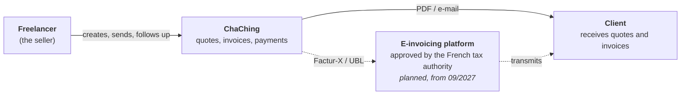
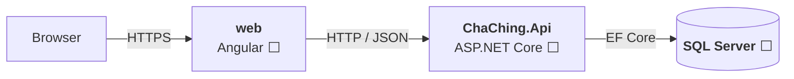
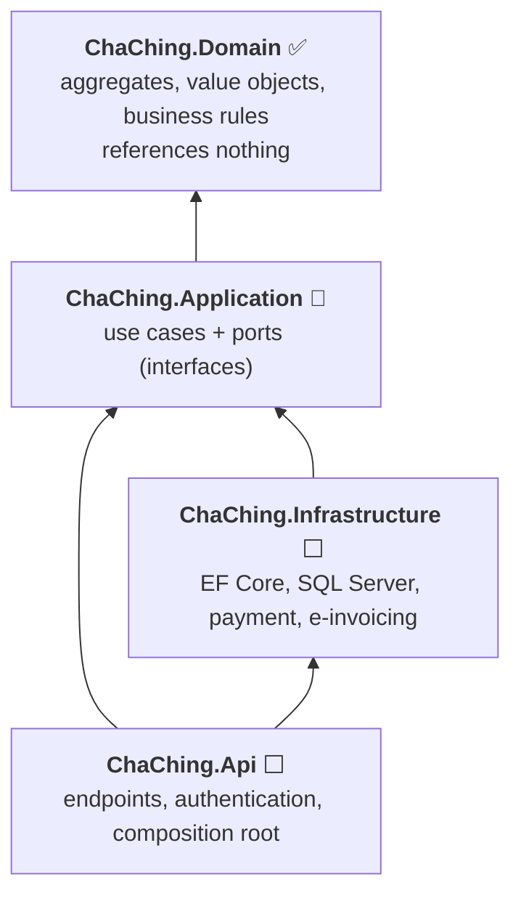
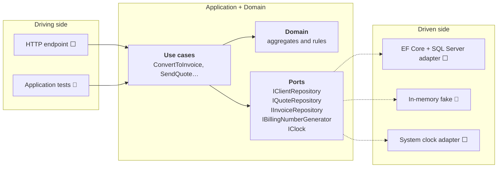

# Architecture

How ChaChing is built, and why it is built that way. Diagrams are [Mermaid](https://mermaid.js.org/), so they live in the repository and are reviewed like code. The structure follows the [C4 model](https://c4model.com/) (context, containers, components); each decision has its [ADR](adr/README.md).

**Status legend:** ✅ built · 🔨 in progress · ⬜ planned.

## 1. Context

ChaChing is a billing application for creative freelancers: quotes, invoices, payments, with the legal rules of French invoicing built into the model.



## 2. Containers



The Angular front end lives in the same repository (`web/`), outside the .NET solution ([ADR 0008](adr/0008-solution-and-folder-layout.md)). It only talks to the API; it never sees the database.

## 3. Layers and the dependency rule



**The rule: dependencies point towards the Domain, never away from it.**

| Layer | Holds | Knows | Never knows |
|---|---|---|---|
| **Domain** | aggregates (`Quote`, `Invoice`, `Client`, `Seller`), value objects (`Money`, `Discount`, `BillingNumber`…), the quote-to-invoice converter | nothing | database, HTTP, clock, framework |
| **Application** | one class per use case, the ports (`IClientRepository`…) | Domain | database, HTTP |
| **Infrastructure** | adapters implementing the ports: EF Core repositories, numbering counter, e-invoicing | Application, Domain | the API |
| **Api** | endpoints, authentication, mapping to DTOs, wiring of the implementations to the ports (composition root) | all of them | — |

The compiler enforces the rule: each layer is a project, and a project cannot reference what is not in its `.csproj` ([ADR 0008](adr/0008-solution-and-folder-layout.md)).

## 4. Ports and adapters (hexagonal)

The application is a hexagon with the use cases at its centre. What *drives* it (an HTTP request, a test) and what it *drives* (a database, a clock) both plug in through interfaces.



A **port** is an interface declared by the application, in its own vocabulary ([ADR 0031](adr/0031-repository-ports-in-application.md)). An **adapter** is the technology-specific code that implements it. A port appears with the first use case that needs it, not before.

## 5. Where a rule lives

A rule is placed by what it needs to be decided. The same business sentence can have several guards at different levels (defence in depth). Example: "a quote cannot be invoiced twice".

| Level | Guard | Why there |
|---|---|---|
| **Domain** | only an `Accepted` quote converts; an issued invoice never changes | needs only the object's own state |
| **Use case** | no non-cancelled invoice already exists for this `QuoteId` ([ADR 0034](adr/0034-already-invoiced-rule-in-use-case.md)) | needs to look at *other* aggregates, through a port |
| **Database** | a unique index on `QuoteId` for non-cancelled invoices | the use case alone cannot stop two simultaneous requests (read-then-write race) |

The question to ask: *does the rule need only this object's state and business vocabulary?* Then it is the domain's. Does it need to look elsewhere? Then it is a use case. Does it need to be true even under concurrency? Then the database backs it too.

## 6. Cross-cutting decisions

| Concern | Decision | ADR |
|---|---|---|
| **Money** | immutable value object, signed, 2 decimals, rounded at construction; VAT computed once per rate | [0003](adr/0003-money-value-object.md), [0020](adr/0020-vat-breakdown-pro-rata.md) |
| **Time** | the domain never reads the clock: today's date is a parameter. The application gets it from an `IClock` port | [0029](adr/0029-invoice-lifecycle.md) |
| **Numbering** | gapless per seller, type and year; counter row incremented in the same transaction as the save | [0013](adr/0013-gapless-numbering.md) |
| **Consistency** | one aggregate, one transaction; aggregates refer to each other by id | [0010](adr/0010-quote-aggregate.md) |
| **Legal immutability** | parties' details are snapshotted into a document when it is sent | [0012](adr/0012-multi-seller-and-snapshots.md) |
| **Multi-tenancy** | every aggregate carries a `SellerId`; every repository query is scoped to the authenticated seller ⬜ | [0012](adr/0012-multi-seller-and-snapshots.md) |
| **Errors** | `ArgumentException` for a bad argument, `InvalidOperationException` for a forbidden state; the API maps them to `ProblemDetails` ⬜ | [0027](adr/0027-argument-validator.md), [0018](adr/0018-quote-lifecycle.md) |
| **Vocabulary** | EN 16931 names, so that the future Factur-X export is a mechanical translation | [0015](adr/0015-vocabulary-follows-en-16931.md) |

## 7. Testing strategy

| Level | What it proves | Tools | Status |
|---|---|---|---|
| **Domain tests** | every business rule, one test per rule, boundaries on both sides | xUnit | ✅ 239 tests, no mock, no database |
| **Application tests** | each use case, with an in-memory fake behind the port | xUnit, hand-written fakes | 🔨 |
| **Integration tests** | the real adapters against a real SQL Server, including the unique index | Testcontainers | ⬜ |
| **API tests** | HTTP contract, status codes, `ProblemDetails` | `WebApplicationFactory` | ⬜ |

The domain being free of any dependency is what makes the first level fast and mock-free.

## 8. Technology

| Part | Choice | Why |
|---|---|---|
| Language, runtime | C# on .NET 10 | strong typing for a domain where a wrong amount is a legal problem |
| Tests | xUnit | de facto standard for .NET |
| Persistence | EF Core on SQL Server ⬜ | the aggregate shape maps naturally; hand-written SQL for reporting queries |
| API | ASP.NET Core ⬜ | — |
| Front end | Angular ⬜ | typed, structured, widely used for business applications |
| Delivery | Docker, GitHub Actions ⬜ | reproducible build and tests on every push |

## 9. Solution layout

```
ChaChing/
├── ChaChing.slnx
├── src/
│   ├── ChaChing.Domain/             ✅
│   ├── ChaChing.Application/        🔨
│   ├── ChaChing.Infrastructure/     ⬜
│   └── ChaChing.Api/                ⬜
├── tests/
│   ├── ChaChing.Domain.Tests/       ✅
│   ├── ChaChing.Application.Tests/  🔨
│   └── ChaChing.IntegrationTests/   ⬜
├── web/                             ⬜ Angular, outside the solution
└── docs/                            architecture, domain model, use cases, ADRs
```
