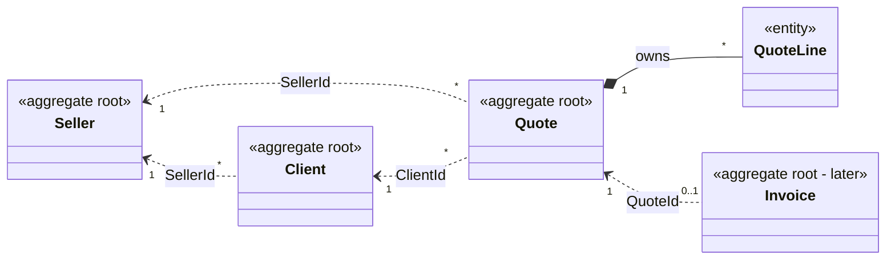
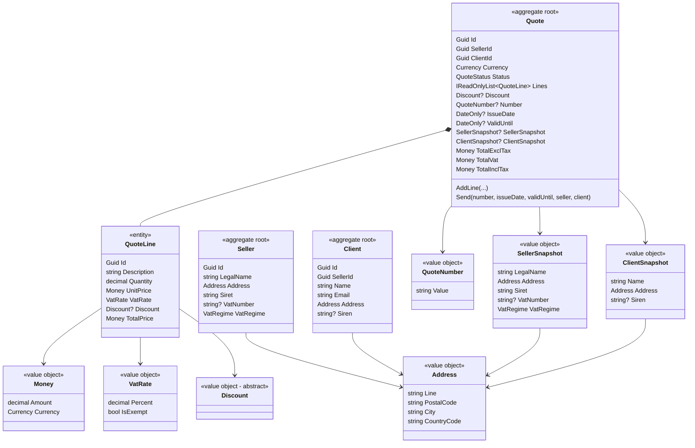
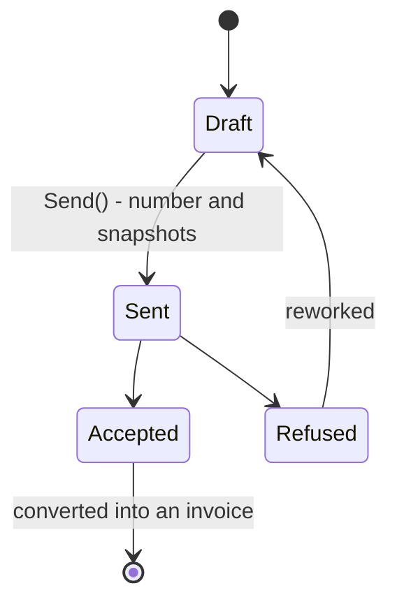

# Domain model

The map of the domain: which aggregate owns which data, and how they refer to each other.
The database schema (P3) will be derived from it, not the other way round.
The decisions behind it are in [`adr/`](adr/README.md).

**Vocabulary:** names follow the European e-invoicing standard **EN 16931** (the one behind Factur-X, UBL and CII), with one exception: `Client`, not `Buyer` (ADR 0015).

## 1. Aggregates and references

- **Solid line (`*--`)**: the quote **owns** its lines. They are reached through the quote only, and live and die with it.
- **Dotted line (`<..`)**: a reference **by id** to another aggregate, never an object. Each aggregate is loaded and saved on its own.
- Every aggregate except `Seller` carries a `SellerId`: that is what separates the data of each freelancer.

## 2. Inside each aggregate

## 3. Where each piece of data goes

| Data | Owner | How the quote gets it | EN 16931 |
|---|---|---|---|
| Seller: legal name, address, SIRET, VAT number, VAT regime | `Seller` | `SellerId`, then a **snapshot** when sent | Seller (BG-4) |
| Client: name, address, SIREN (B2B) | `Client` | `ClientId`, then a **snapshot** when sent | Buyer (BG-7) |
| Number, issue date | `Quote` | set by `Send()` | BT-1, BT-2 |
| Currency | `Quote` | at creation | BT-5 (ISO 4217, as `Currency`) |
| Lines: description, quantity, unit price excl. tax, VAT rate | `QuoteLine` | owned | invoice line (BG-25) |
| Totals excl. tax, VAT, incl. tax | `Quote` | **computed**, never stored | document totals (BG-22) |
| Numbering counter (seller, type, year → last number) | infrastructure | behind a port, in the send transaction | — |

## 4. Lifecycle of a quote

- **Draft**: editable, no number, references only.
- **Sent**: frozen. It has a number and snapshots of both parties.

## 5. Out of the MVP

- **E-invoicing (French reform):** from 1 September 2027, a freelancer must **issue** B2B invoices through an approved platform, in Factur-X, UBL or CII. ChaChing will not become a platform: it will send through one, behind a port (`IInvoiceTransmitter`), one adapter per platform.
- Product catalogue, credit notes, quote versioning (ADR 0010).
