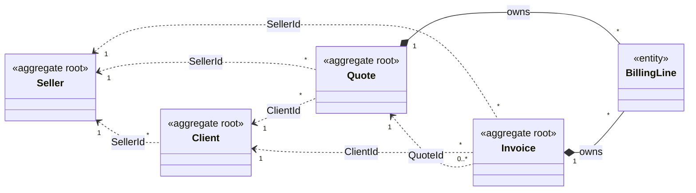
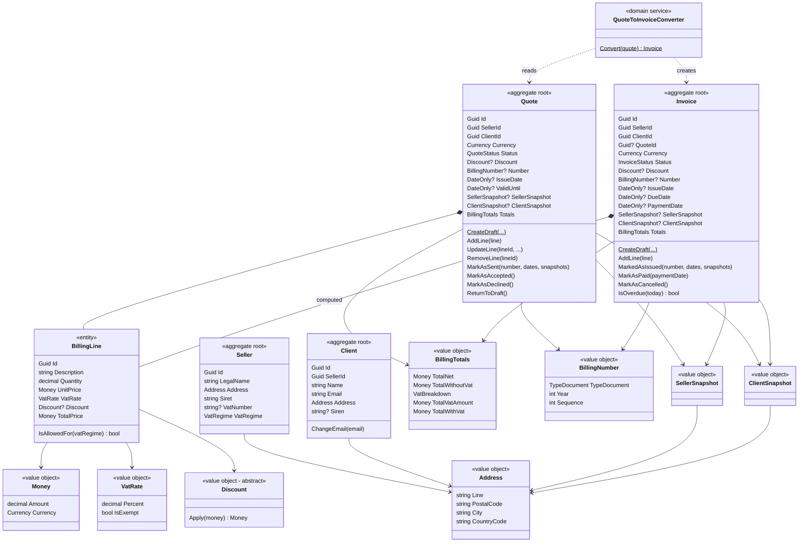
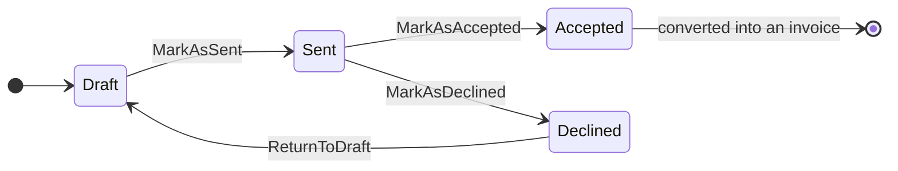
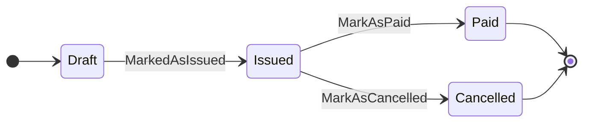
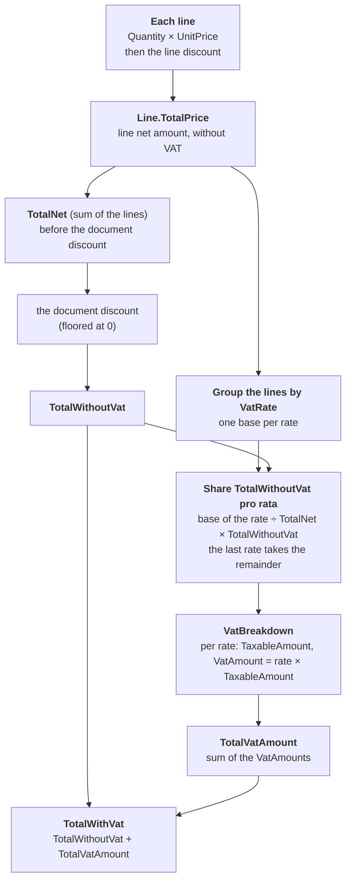

# Domain model

The map of the domain: what the words mean, which aggregate owns which data, how a document lives and how its amounts are computed. It describes the code as it is; the reasons are in the [ADRs](adr/README.md).

The database schema will be **derived from this model**, not the other way round.

## 1. Ubiquitous language

Names follow the European e-invoicing standard **EN 16931** (the one behind Factur-X, UBL and CII), with one exception: `Client`, not `Buyer` ([ADR 0015](adr/0015-vocabulary-follows-en-16931.md)).

| Term | Meaning |
|---|---|
| **Seller** | The freelancer who uses ChaChing. Every other aggregate belongs to one seller. |
| **Client** | Who the seller bills (a company, identified by SIREN, or a person). |
| **Quote** | A priced offer sent to a client. Draft → sent → accepted or declined. |
| **Invoice** | The legal billing document. Once issued, it never changes. |
| **Billing line** | One priced item of a document: description, quantity, unit price, optional discount, VAT rate. |
| **Discount** | A reduction, in percent or a fixed amount, on a line or on a document total. |
| **Snapshot** | The parties' details frozen into a document the day it is sent or issued. |
| **Billing number** | The public reference of a sent document, `QUO-2026-0042`, gapless per seller, type and year. |
| **VAT breakdown** | The VAT of a document, one subtotal per rate (EN 16931 BG-23). |
| **Exempt seller** | A seller under *franchise en base*: no VAT, the mention "art. 293 B du CGI". |

## 2. Aggregates and references

- **Solid line (`*--`)**: the document **owns** its lines. They are reached through the document only, and live and die with it. `BillingLine` is one type, but each document has its own instances ([ADR 0024](adr/0024-invoice-aggregate-shared-lines-and-totals.md)).
- **Dotted line (`<..`)**: a reference **by id** to another aggregate, never an object. Each aggregate is loaded and saved on its own, in one transaction per aggregate.
- Every aggregate except `Seller` carries a `SellerId`: that is what separates the data of each freelancer.
- `Invoice.QuoteId` is optional: an invoice can exist without a quote. A quote can be invoiced again only if its previous invoices are cancelled ([ADR 0032](adr/0032-quote-to-invoice-converter.md), [0034](adr/0034-already-invoiced-rule-in-use-case.md)).

## 3. Inside each aggregate

Value objects are immutable and compared by value; entities are compared by `Id` ([ADR 0001](adr/0001-entities-identity-and-factories.md), [0003](adr/0003-money-value-object.md)). `SellerSnapshot` and `ClientSnapshot` hold copies of the fields of their source plus its id ([ADR 0012](adr/0012-multi-seller-and-snapshots.md), [0019](adr/0019-snapshots-built-from-aggregates.md)).

## 4. Where each piece of data goes

| Data | Owner | How a document gets it | EN 16931 |
|---|---|---|---|
| Seller: legal name, address, SIRET, VAT number, VAT regime | `Seller` | `SellerId`, then a **snapshot** when sent | Seller (BG-4) |
| Client: name, address, SIREN (B2B) | `Client` | `ClientId`, then a **snapshot** when sent | Buyer (BG-7) |
| Number, issue date | the document | set by `MarkAsSent` / `MarkedAsIssued` | BT-1, BT-2 |
| Due date, payment date | `Invoice` | set at issue / at payment | BT-9 |
| Currency | the document | at creation | BT-5 (ISO 4217) |
| Lines: description, quantity, unit price without tax, VAT rate | `BillingLine` | owned | invoice line (BG-25) |
| Totals without tax, VAT, with tax | `BillingTotals` | **computed** from the lines, never stored | document totals (BG-22) |
| Numbering counter (seller, type, year → last number) | infrastructure | behind a port, in the send transaction | — |

## 5. Lifecycles

| | Quote ([ADR 0018](adr/0018-quote-lifecycle.md)) | Invoice ([ADR 0029](adr/0029-invoice-lifecycle.md)) |
|---|---|---|
| **Draft** | editable, no number, references only | editable, no number, references only |
| **After sending / issuing** | frozen: a number, dates, snapshots | frozen, never modified again |
| **Overdue** | — | **derived**, not a status: `IsOverdue(today)` |
| **Number** | kept forever, even after `ReturnToDraft` | gapless, from the `INV` series |

A transition that is not allowed throws `InvalidOperationException` (the state forbids it); a bad argument throws `ArgumentException`.

## 6. How the amounts of a document are computed

**Rule of thumb: every discount comes before the VAT.** Everything stays without VAT until the very last step.

**Worked example**, with a fixed discount of 155 € on the document:

| Step | 20 % | 5.5 % | Document |
|---|---|---|---|
| Lines (`TotalPrice`) | 3 × 500 € − 10 % = **1,350 €** | 1 × 200 € = **200 €** | |
| **TotalNet** (sum of the lines) | | | 1,550 € |
| Document discount (155 € = 10 % of 1,550 €) | | | − 155 € |
| **TotalWithoutVat** | | | **1,395 €** |
| Share of each rate | 1,350 / 1,550 | 200 / 1,550 | |
| **TaxableAmount** | 1,350 / 1,550 × 1,395 = **1,215 €** | the remainder: 1,395 − 1,215 = **180 €** | 1,395 € ✔ |
| **VatAmount** | 243 € | 9.90 € | **TotalVatAmount: 252.90 €** |
| | | | **TotalWithVat: 1,647.90 €** |

Rounding and edge cases (a zero total keeps its breakdown): [ADR 0003](adr/0003-money-value-object.md), [0014](adr/0014-vat-rate-per-line.md), [0020](adr/0020-vat-breakdown-pro-rata.md).

## 7. Business rules by aggregate

| Aggregate | Rules enforced by the domain |
|---|---|
| **Money** | at most 2 decimals, a defined currency; operations never mix currencies |
| **Discount** | rate from 0 to 100 %, fixed amount not negative; result floored at zero; same currency as the total |
| **BillingLine** | description required, quantity > 0, unit price ≥ 0 |
| **Seller** | SIRET of 14 digits, VAT regime defined, VAT number normalised |
| **Client** | name, email, address required; belongs to a seller |
| **Quote** | one currency; lines editable in draft only; sent with ≥ 1 line, a valid-until date not before the issue date, snapshots of its own seller and client, a `QUO` number; an exempt seller cannot send a line with VAT; keeps its number forever |
| **Invoice** | same as the quote, with an `INV` number and a due date; issued once and then immutable; paid on or after the issue date; cancelled only from `Issued` |
| **Quote → Invoice** | only an accepted quote converts; lines are copied, never shared; the draft invoice has no number yet |

Rules that need the outside world are **not** in the domain: whether a client exists, whether a quote was already invoiced, the next number, today's date. They belong to the use cases ([use cases](use-cases.md)).

## 8. Out of the MVP

- **E-invoicing (French reform):** from 1 September 2027 a freelancer must **issue** B2B invoices through an approved platform, in Factur-X, UBL or CII. ChaChing will not become a platform: it will send through one, behind a port (`IInvoiceTransmitter`), with one adapter per platform.
- Credit notes (`CRE` series), partial payments, quote versioning, product catalogue, expired quotes.
