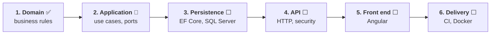

# Roadmap

ChaChing is built **from the inside out**: the business rules first, then the use cases, then each technical layer in turn. Each phase leaves the repository in a working, tested state. The design leads; the code follows at the pace of the design.

**Status legend:** ✅ done · 🔨 in progress · ⬜ planned.

## 1. Domain ✅

- Money, discounts, VAT per line with a breakdown per rate, shared by quote and invoice.
- `Client`, `Seller`, `Quote` (full lifecycle), `Invoice` (draft, issued, paid, cancelled, overdue derived).
- Snapshots of the parties, gapless billing numbers, exempt-seller rules.
- Quote-to-invoice conversion.
- 235 unit tests, no mock, no database. 19 ADRs.

## 2. Application 🔨

- Project, ports declared next to the use cases, an in-memory fake per port.
- Use cases in the order of the freelancer's journey: [catalogue](use-cases.md#1-catalogue).
- Built: `CreateClient` (the skeleton every other use case copies: port, fake, test, code) `SetUpSeller` and `CreateDraftQuote`. Ports are asynchronous ([ADR 0038](adr/0038-repository-ports-are-asynchronous.md)). Next: `AddQuoteLine`.

## 3. Persistence ⬜

- EF Core mapping of the aggregates, including value objects (`Money`, `BillingNumber`) and snapshots; migrations.
- The **schema is derived from the [domain model](domain-model.md)**, not the other way round.
- Numbering counter table, incremented in the same transaction as the save ([ADR 0013](adr/0013-gapless-numbering.md)).
- Unique index backing "a quote is invoiced once" ([ADR 0034](adr/0034-already-invoiced-rule-in-use-case.md)).
- Hand-written SQL for reporting queries (overdue invoices), not routed through the aggregates.
- Integration tests against a real SQL Server with Testcontainers.

## 4. API and security ⬜

- REST endpoints, `ProblemDetails` for errors, validation, versioning, CORS.
- Authentication, and the **tenant rule**: every query scoped to the authenticated seller.
- Logging and tracing (Serilog, OpenTelemetry).
- A decision record on how far to go with CQRS: a simple split between commands and queries, without a mediator library.

## 5. Front end ⬜

- Angular application on top of the real API: quote editor, invoice list, payment follow-up.
- Presentation of documents (PDF) shaped by the seller's identity.

## 6. Delivery ⬜

- Dockerfile, GitHub Actions (build, test, integration tests), deployment.
- README and docs reviewed for a reader who has never seen the project.

## Beyond the MVP

| Topic | Note |
|---|---|
| **E-invoicing** | Factur-X / UBL export and transmission to an approved platform, behind an `IInvoiceTransmitter` port, one adapter per platform. Required for issuing B2B invoices from 1 September 2027. |
| **Credit notes** | `CRE` series, linked to the invoice; unlocks `Cancelled` ([ADR 0029](adr/0029-invoice-lifecycle.md)). A third billing document may justify a shared base ([ADR 0024](adr/0024-invoice-aggregate-shared-lines-and-totals.md)). |
| **Partial payments** | deliberately left out until a real case appears |
| **Quote versioning, expired quotes, product catalogue** | see [ADR 0010](adr/0010-quote-aggregate.md) and [0018](adr/0018-quote-lifecycle.md) |
| **Mobile client** | a second client of the same API, which the layering makes cheap |
| **Rounding rule** | `ToEven` today; French practice often rounds half up. To settle with an accountant ([ADR 0003](adr/0003-money-value-object.md)) |

## Open design questions

- Modifying an accepted quote (impossible today).
- Abandoning a draft invoice: a draft cannot be cancelled and blocks a new conversion ([use case 10](use-cases.md#1-catalogue)).
- A discount on the document total editable while in draft (set at creation only today).
- A payment dated in the future: the domain does not read the clock, so the use case must control it.
