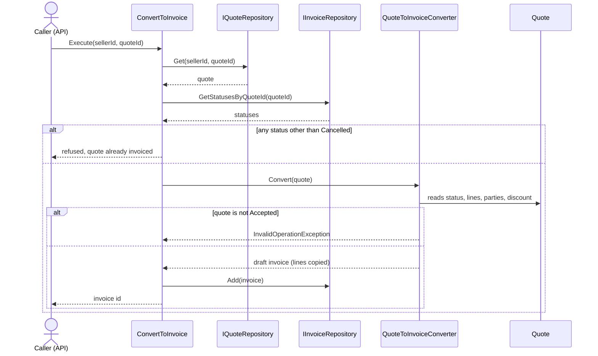
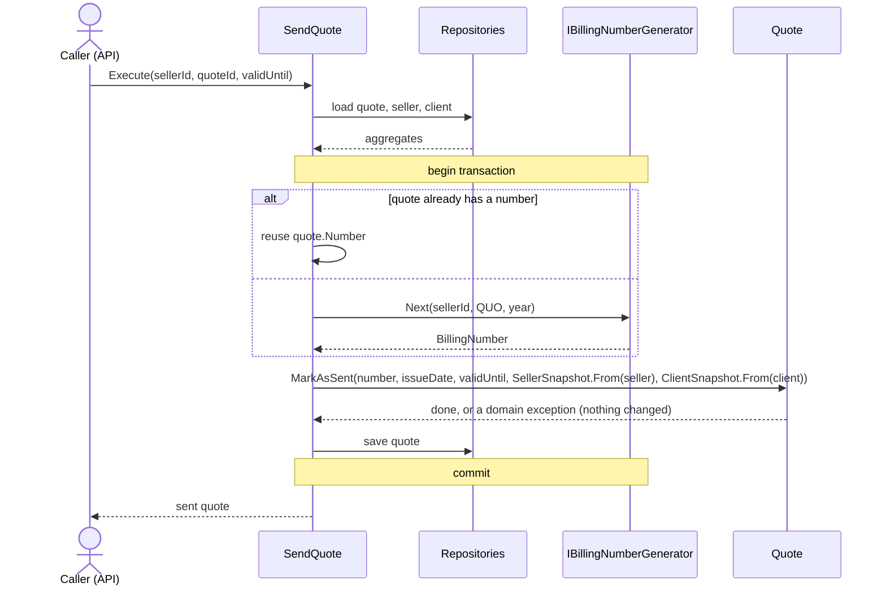

# Use cases

The Application layer holds one class per use case. A use case **orchestrates**: it loads aggregates through ports, calls the domain, saves. It holds no business rule that the domain can hold itself, and it holds the rules that need to look *across* aggregates or at the outside world ([architecture §5](architecture.md#5-where-a-rule-lives)).

**Status legend:** ✅ built · 🔨 in progress · ⬜ planned. Everything not built is a design target; names and signatures may still change.

## 1. Catalogue

In the order of a freelancer's journey.

| # | Use case | What it does | Rules it carries (beyond the domain's) | Ports | |
|---|---|---|---|---|---|
| 1 | **CreateClient** | adds a client for a seller | the seller exists ([ADR 0036](adr/0036-seller-existence-checked-by-use-case.md)) | `IClientRepository`, `ISellerRepository` | ✅ |
| 2 | **SetUpSeller** | registers the seller | "one seller per account" waits for the notion of account (authentication) | `ISellerRepository` | ✅ |
| 3 | **CreateDraftQuote** | creates an empty draft | the client exists and belongs to the seller, one error for both ([ADR 0039](adr/0039-client-ownership-checked-by-use-case.md)) | `IQuoteRepository`, `IClientRepository` | ✅ |
| 3b | **AddQuoteLine** | adds a line to a draft (update and remove: separate use cases, when needed) | the quote exists; default VAT rate from the seller's regime | `IQuoteRepository`, `ISellerRepository` | ⬜ |
| 4 | **SendQuote** | sends the quote: number, snapshots | reuse the quote's number if it has one, else take the next; one transaction with the save | + `IBillingNumberGenerator`, `IClock` | ⬜ |
| 5 | **Accept / Decline / Reopen quote** | records the client's answer | — | `IQuoteRepository` | ⬜ |
| 6 | **ConvertToInvoice** | accepted quote → draft invoice | never twice for the same quote ([ADR 0034](adr/0034-already-invoiced-rule-in-use-case.md)) | `IQuoteRepository`, `IInvoiceRepository` | ⬜ (converter ✅) |
| 7 | **IssueInvoice** | issues the invoice: number, due date, snapshots | same numbering as the quote | + `IBillingNumberGenerator` | ⬜ |
| 8 | **RecordPayment** | marks the invoice paid | a payment date in the future is refused here, the domain does not read the clock | `IInvoiceRepository`, `IClock` | ⬜ |
| 9 | **CancelInvoice** | cancels an issued, unpaid invoice | — | `IInvoiceRepository` | ⬜ |
| 10 | **DiscardDraftInvoice** | deletes a draft invoice, which cannot be cancelled and would block a new conversion | only a draft | `IInvoiceRepository` | ⬜ |
| 11 | **ListOverdueInvoices** | read-only list of late invoices | a query, not routed through the domain | `IInvoiceQueries` | ⬜ |

Credit notes, partial payments and e-invoicing transmission come after the MVP ([domain model §8](domain-model.md#8-out-of-the-mvp)).

## 2. Ports

A port appears with the first use case that needs it ([ADR 0031](adr/0031-repository-ports-in-application.md)).

| Port | Answers | Appears with |
|---|---|---|
| `IClientRepository` | add a client, does it exist for this seller | #1, #3 |
| `ISellerRepository` | add a seller, does it exist (`Get` when a use case reads it) | #1 |
| `IQuoteRepository` | add a quote (find, save with #3b) | #3 |
| `IBillingNumberGenerator` | the next number for (seller, type, year), inside the caller's transaction | #4 |
| `IInvoiceRepository` | find, add, save an invoice; the statuses of the invoices of a quote | #6 |
| `IClock` | today's date | #4, #8 |
| `IInvoiceQueries` | read models that skip the aggregates | #11 |

## 3. Sequence: `ConvertToInvoice`

The double-billing rule is the use case's, the acceptance rule is the converter's.

## 4. Sequence: `SendQuote`

Numbering is the delicate part: the number is taken **inside the transaction** that saves the sent quote, so a failure never leaves a gap ([ADR 0013](adr/0013-gapless-numbering.md)).

## 5. How a use case is built

1. **The need**, in the freelancer's words.
2. **The ports** it requires, and only those.
3. **One test per rule**, against an in-memory fake behind each port.
4. **The code**, as little as makes the tests pass.
5. **An ADR** if a design decision was made on the way (as for [0034](adr/0034-already-invoiced-rule-in-use-case.md)).
